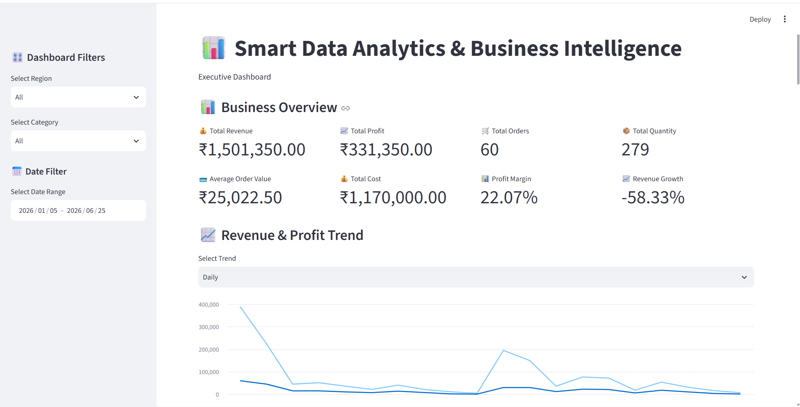
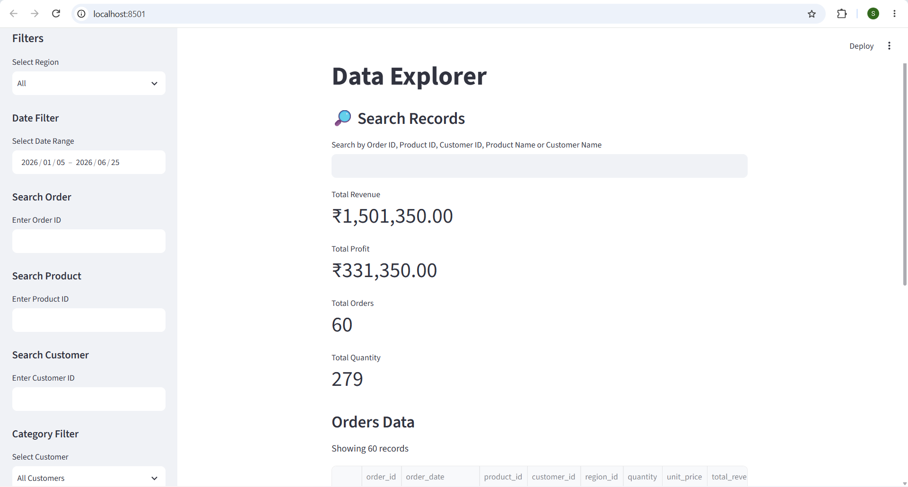
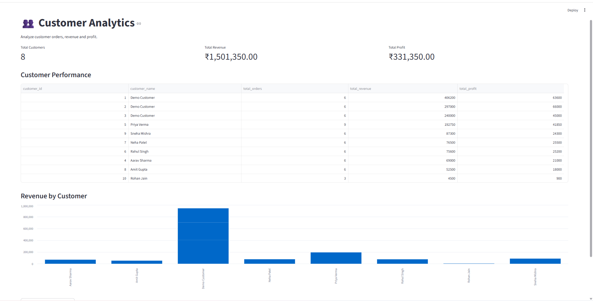

Smart Data Analytics & Business Intelligence

🚀 **Live Dashboard:** [Open Smart BI Analytics](https://smart-bi-analytics-sas4btsmkk9x4tppzbneiv.streamlit.app/)

📊 Project Overview

Smart Data Analytics & Business Intelligence is a Python-based project designed to explore business data and analyze customer, product, revenue, and profit performance through interactive dashboards.

✨ Features

- Executive business dashboard
- Revenue and profit KPIs
- Product revenue analysis
- Region and category filters
- Interactive data explorer
- Customer analytics and performance table
- Revenue by customer chart
- CSV report download
- MySQL database integration

🛠️ Technologies Used

- Python
- Streamlit
- Pandas
- MySQL
- SQLAlchemy
- Plotly
- Matplotlib

📁 Project Structure

Smart-BI-Analytics/
├── config/
├── dashboard/
│   ├── assets/
│   ├── components/
│   ├── pages/
│   ├── app.py
│   ├── data_explorer.py
│   └── customer_analytics.py
├── data/
│   ├── raw/
│   └── processed/
├── database/
│   └── schema.sql
├── notebooks/
├── reports/
├── src/
├── tests/
├── .gitignore
├── requirements.txt
└── README.md

⚙️ Setup

1. Install Python and MySQL.
2. Open the project folder in PyCharm.
3. Activate the project's virtual environment.
4. Install dependencies:

pip install -r requirements.txt

5. Configure database credentials in the local ".env" file.
6. Ensure the MySQL database and required tables are available.

▶️ Run the Application

Run these commands from the project root.

Executive Dashboard

python -m streamlit run dashboard/app.py

Data Explorer

python -m streamlit run dashboard/data_explorer.py

Customer Analytics

python -m streamlit run dashboard/customer_analytics.py

🔐 Security

Never upload ".env" files, passwords, or other database credentials to a public repository.

🎯 Objective

To transform business data into useful insights through interactive visualizations, customer analysis, and business performance reporting.
